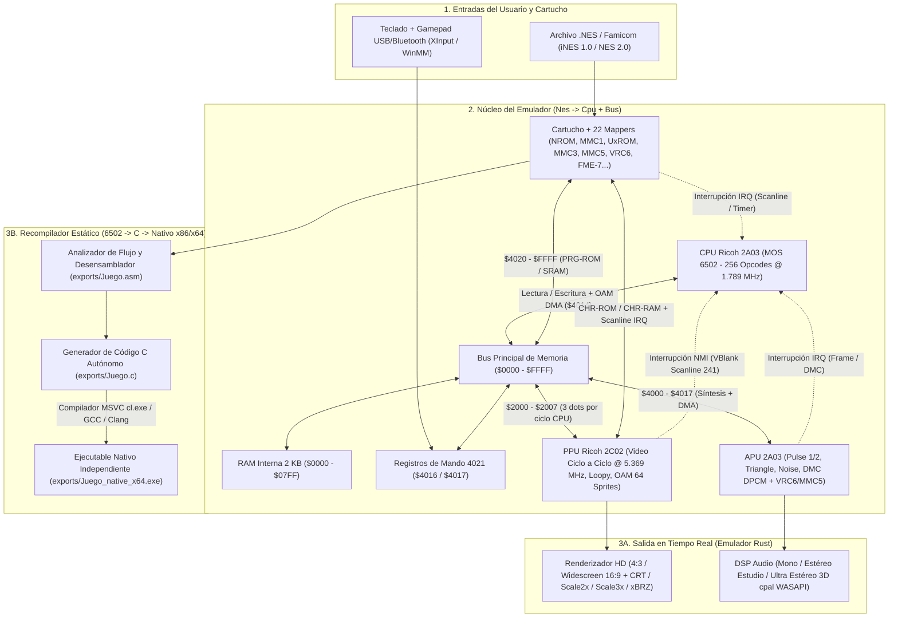
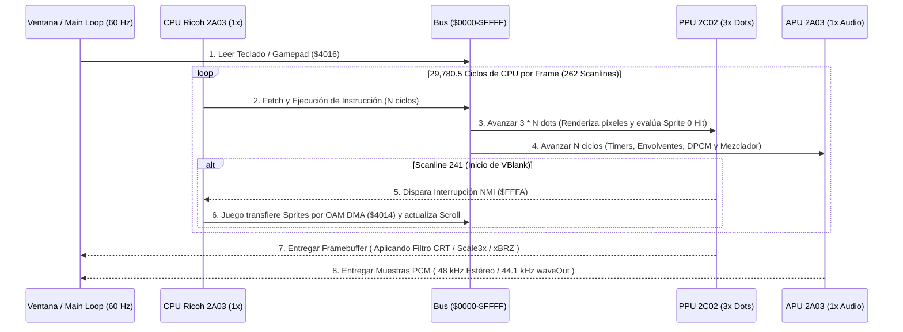

# NesEmuRust — Emulador NES/Famicom y Recompilador Estático 6502 a C / x86-x64

**`NesEmuRust`** es un emulador de **Nintendo Entertainment System (NES - NTSC) y Famicom** escrito 100% en **Rust** siguiendo las especificaciones de hardware de la [NESdev Wiki](https://www.nesdev.org/wiki/Nesdev_Wiki). Además de la emulación ciclo a ciclo, incluye una suite de **ingeniería inversa y recompilación estática** capaz de desensamblar cualquier ROM `.nes` a ensamblador `6502` (`.asm`), traducirla a código **C estándar autónomo (`.c`)** y compilarla en un **ejecutable nativo independiente (`.exe` x86/x64)** con gráficos PPU, sonido APU de 5 canales y soporte de mandos sin depender del emulador ni del archivo `.nes`.

---

## Diagrama de Arquitectura del Sistema

### 1. Arquitectura de Hardware Emulado y Pipeline de Recompilación



### 2. Ciclo de Ejecución de un Frame NTSC (`60.0988 FPS`)



---

## Características Principales

### 1. Emulación de Hardware NES / Famicom Ciclo a Ciclo
- **CPU Ricoh 2A03 (MOS 6502)**: Implementación completa de los **256 opcodes** (151 oficiales + 105 no oficiales), frecuencia exacta NTSC (`1.789773 MHz`), penalizaciones por cruce de página, bug hardware de `JMP ($xxFF)`, interrupciones (`NMI`, `IRQ`, `RESET`) y transferencia DMA de OAM (`$4014`).
- **PPU Ricoh 2C02**: Renderizado preciso por scanline y dot (`3x` reloj CPU), registros internos Loopy (`v, t, x, w`), detección exacta de `Sprite 0 Hit`, *Odd-Frame Cycle Skip*, énfasis de color (`PPUMASK` bits 5–7) y opción para eliminar el parpadeo clásico permitiendo hasta **64 sprites por scanline**.
- **APU Ricoh 2A03 + Audio de Expansión**:
  - 5 canales nativos: **Pulse 1**, **Pulse 2** (con *sweep* y envolventes), **Triangle**, **Noise** (LFSR de 15 bits) y **DMC / DPCM** con lectura DMA de muestras delta de 1 bit.
  - Chips de audio expandido Famicom: **Konami VRC6** (2 pulsos + diente de sierra) y **Nintendo MMC5**.
  - **3 modos de salida de audio (`F6`)**: *Mono Original (NES)*, *Estéreo Estudio + Bass* y *Ultra Estéreo 3D + Sub-Bass* (efecto espacial Haas + refuerzo de sub-graves), con mezclador individual por canal y osciloscopio en vivo.
- **22 Mappers Soportados**:
  - `0` (NROM), `1` (MMC1 / SxROM), `2` (UxROM), `3` (CNROM), `4 / 206` (MMC3 / TxROM con contador IRQ de scanline), `5` (MMC5 / ExROM), `7` (AxROM), `16 / 153 / 159` (Bandai FCG), `19` (Namco 163), `21 / 22 / 23 / 25` (Konami VRC2/VRC4), `24 / 26` (Konami VRC6), `34 / 66 / 71 / 87 / 184` (BNROM, GxROM, Camerica, Jaleco, Sunsoft-1), `69` (Sunsoft FME-7 / 5B), `75` (Konami VRC1) y `85` (Konami VRC7).

### 2. Mejoras Visuales y Persistencia
- **Widescreen 16:9 Real (`426x240`, `F9`)**: Renderiza columnas adicionales reales desde las *NameTables* adyacentes sin estirar la relación de aspecto 4:3, detectando cortes de HUD por scanline.
- **Filtros de Escalado en Tiempo Real (`F10`)**: *Pixel Nítido (Nearest)*, *CRT Trinitron (Scanlines 2x)*, *Scale2x (EPX)*, *Scale3x* y *xBRZ*.
- **Batería SRAM y Save States**:
  - Guardado automático de memoria respaldada por batería en `saves/<juego>.sav`.
  - Puntos de guardado instantáneos (`.nst`) en 5 ranuras (`Slots 1–5`) con atajos rápidos (`F5` Guardar / `F4` Cargar).

### 3. Desensamblador 6502 y Recompilador Estático a C / Nativo x86-x64
- **Desensamblado Completo (`.asm`)**: Análisis de flujo de control desde los vectores `RESET` (`$FFFC`), `NMI` (`$FFFA`) e `IRQ` (`$FFFE`), detección de despachadores de tablas inline (como en juegos de Konami), etiquetado automático de subrutinas (`sub_XXXX`, `loc_XXXX`) y clasificación semántica (`[SPRITES / OAM DMA]`, `[FONDO / PPU]`, `[AUDIO / APU]`, `[LECTURA DE MANDO]`).
- **Decompilación / Recompilación a C (`.c`) y Ejecutable `.exe` Autónomo**:
  - Genera un único archivo `.c` sin dependencias externas que embebe los bancos `PRG_ROM` (niveles, música, lógica) y `CHR_MEM` (sprites y tiles).
  - Incluye en el propio `.c` soporte multi-mapper (`NROM`, `MMC1`, `UxROM`, `CNROM`, `MMC3` con IRQ de scanline, `AxROM`, `FME-7`), renderizador PPU por scanline, **sintetizador APU de 5 canales con salida de audio Win32 `waveOut` a 44.1 kHz**, soporte de teclado + Gamepad USB/Bluetooth (`joyGetPosEx`) y bucle principal Win32 a `60.0988 FPS`.
  - Compila automáticamente a `.exe` nativo optimizado (`/O2` / `-O2`) detectando **MSVC (`cl.exe` / `vswhere`)**, **GCC** o **Clang**.

---

## Guía de Descarga, Requisitos y Compilación Paso a Paso

### 1. Requisitos Previos en Windows
1. **Rust y Cargo** (Edición 2021+):
   - Descarga e instala desde **[https://rustup.rs](https://rustup.rs)** o mediante `winget`:
     ```powershell
     winget install Rustlang.Rustup
     ```
2. **Compilador de C/C++** *(necesario tanto para el enlazador de Rust en Windows como para compilar los ports `.c` a `.exe` nativos)*:
   - **Opción A (Recomendada)**: **Visual Studio Build Tools (C++)** (`cl.exe`):
     ```powershell
     winget install Microsoft.VisualStudio.2022.BuildTools --override "--wait --passive --add Microsoft.VisualStudio.Workload.VCTools --includeRecommended"
     ```
   - **Opción B**: **GCC (MinGW-w64)** o **Clang (LLVM)** agregados a tu variable `PATH`.

---

### 2. Descargar y Compilar el Emulador desde Cero
Abre una terminal de **PowerShell** o **CMD** y ejecuta:

```powershell
# 1. Clonar el repositorio oficial
git clone https://github.com/iztaneo/NesEmuRust.git
cd NesEmuRust

# 2. Compilar el ejecutable optimizado (Release con LTO)
cargo build --release

# 3. Ejecutar la suite de 16 pruebas automatizadas para verificar tu compilación
cargo test

# 4. Iniciar el emulador (el binario compilado queda en target\release\nes_emu_rust.exe)
.\target\release\nes_emu_rust.exe
```

*(También puedes ejecutar directamente el script [`Instalar_NesEmuRust.bat`](Instalar_NesEmuRust.bat) incluido en la raíz para instalar un acceso directo de escritorio).*

---

## Uso desde Línea de Comandos (CLI) e Interfaz Gráfica (GUI)

### Modo Interfaz Gráfica (GUI)
```powershell
# Iniciar el emulador con su ROM de demostración integrada
cargo run --release

# Iniciar el emulador cargando directamente un archivo .nes
cargo run --release -- "ruta/a/tu_juego.nes"
```
*(Dentro de la GUI también puedes abrir el panel **`🔧 Debug`** y pulsar **`💾 Exportar .ASM + .C`** o **`🚀 Compilar y Ejecutar Nativo x86 (.EXE)`**).*

### Modo Línea de Comandos (CLI — Desensamblado y Compilación Nativa)
```powershell
# 1. Solo exportar el ensamblador 6502 (.asm) y el código C (.c) en la carpeta exports/
cargo run --release -- --dump "ruta/a/tu_juego.nes"

# 2. Exportar .asm + .c y compilar automáticamente a ejecutable nativo x86/x64 (.exe)
cargo run --release -- --compile "ruta/a/tu_juego.nes"

# 3. Exportar, compilar y lanzar inmediatamente el ejecutable nativo independiente
cargo run --release -- --run-native "ruta/a/tu_juego.nes"

# Mostrar ayuda de comandos
cargo run -- --help
```

### Compilación Manual de un Archivo `.C` Exportado (Opcional)
Si deseas compilar manualmente cualquier archivo `exports/<Juego>.c` por tu cuenta desde la terminal:

```powershell
# Con MSVC (Developer Command Prompt for VS):
cl.exe /O2 "exports\Juego.c" /Fe:"exports\Juego_native_x64.exe" /link user32.lib gdi32.lib winmm.lib

# Con GCC (MinGW-w64):
gcc -O2 "exports/Juego.c" -o "exports/Juego_native_x64.exe" -luser32 -lgdi32 -lwinmm

# Con Clang:
clang -O2 "exports/Juego.c" -o "exports/Juego_native_x64.exe" -luser32 -lgdi32 -lwinmm
```

Los archivos generados se guardan en el directorio `exports/`:
- `exports/<Nombre_ROM>.asm` — Código ensamblador 6502 completo y documentado.
- `exports/<Nombre_ROM>.c` — Código fuente C autocontenido (PPU + APU 5 canales + Mapper + ROM + Win32).
- `exports/<Nombre_ROM>_native_x64.exe` — Ejecutable nativo autónomo para Windows.

---

## Controles

Tanto el emulador en Rust como los ejecutables nativos `.exe` generados en C soportan **Teclado** y **Mandos / Joysticks USB o Bluetooth** (Xbox, PlayStation, 8BitDo, DirectInput/XInput):

| Botón NES | Teclado (Opción 1) | Teclado (Opción 2) | Gamepad (XInput / DirectInput) |
| :--- | :--- | :--- | :--- |
| **D-Pad (Arriba / Abajo / Izq / Der)** | Flechas Direccionales | `W` / `S` / `A` / `D` | D-Pad / Stick Izquierdo |
| **Botón A** | `X` | `J` | Botón Sur / Este (`A` / `B`) |
| **Botón B** | `Z` | `K` | Botón Oeste / Norte (`X` / `Y`) |
| **Start** | `Enter` | — | `Start` / `Options` |
| **Select** | `Shift Derecho` / `Backspace` | — | `Back` / `Select` / `Share` |

### Atajos Rápidos en el Emulador
- **`Espacio`**: Pausar / Reanudar emulación
- **`R`**: Reiniciar consola (Reset)
- **`F4` / `F5`**: Cargar estado (`.nst`) / Guardar estado (`.nst`) en el Slot activo (`1–5`)
- **`F6`**: Alternar modo de audio (*Mono* / *Estéreo Estudio* / *Ultra Estéreo 3D*)
- **`F7`**: Alternar límite de sprites (*8 originales* vs *64 sin parpadeo*)
- **`F9`**: Alternar pantalla *4:3 Original* vs *16:9 Widescreen Real*
- **`F10`**: Alternar filtro gráfico (*Nearest*, *CRT Trinitron*, *Scale2x*, *Scale3x*, *xBRZ*)
- **`F11` / `Esc`**: Pantalla completa / Salir de pantalla completa

---

## Estructura del Proyecto y Pruebas

```text
NesEmuRust/
├── Cargo.toml                  # Configuración del paquete y dependencias Rust
├── README.md                   # Este documento
├── PLAN_DE_MEJORAS.md          # Hoja de ruta de mejoras del emulador y del generador C
├── WIKI_ARQUITECTURA.md        # Documentación técnica detallada de la arquitectura
├── exports/                    # Salida de desensamblados (.asm), código C (.c) y binarios (.exe)
├── saves/                      # Archivos de batería SRAM (.sav) y Save States (.nst)
└── src/
    ├── main.rs                 # Entrada CLI (--dump, --compile, --run-native) y arranque GUI eframe
    ├── lib.rs                  # Librería principal y suite de 16 pruebas unitarias y de integración
    ├── nes.rs                  # Coordinador CPU + Bus + DMA
    ├── bus.rs                  # Mapa de memoria CPU ($0000-$FFFF)
    ├── controller.rs           # Registros de mando ($4016/$4017)
    ├── cpu/                    # Ricoh 2A03, 256 opcodes, desensamblador y recompilador estático a C
    ├── ppu/                    # Ricoh 2C02, paleta NTSC, Widescreen 16:9 y filtros HD
    ├── apu/                    # Síntesis de 5 canales + DPCM + VRC6/MMC5 + DSP Estéreo 3D
    ├── cartridge/              # Lector iNES / NES 2.0 y 22 Mappers
    └── ui/                     # Interfaz egui/eframe, audio cpal (WASAPI) y lector de Gamepads
```

Para ejecutar la suite de pruebas automatizadas (CPU, PPU, APU DPCM, Mappers, SRAM/Save States y recompilador C):

```powershell
cargo test
```

Para más detalles sobre el diseño interno y el roadmap de evolución del proyecto, consulta [`WIKI_ARQUITECTURA.md`](WIKI_ARQUITECTURA.md) y [`PLAN_DE_MEJORAS.md`](PLAN_DE_MEJORAS.md).
